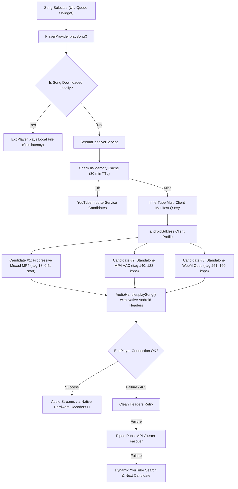

# ⚡ SINE — High-Fidelity Music Streaming (100% Free & Open Source)

<div align="center">

```
  ███████╗██╗███╗   ██╗███████╗
  ██╔════╝██║████╗  ██║██╔════╝
  ███████╗██║██╔██╗ ██║█████╗  
  ╚════██║██║██║╚██╗██║██╔══╝  
  ███████║██║██║ ╚████║███████╗
  ╚══════╝╚═╝╚═╝  ╚═══╝╚══════╝
```

### *Pure acoustics. Zero telemetry. No monthly subscription. 🎧✨*

[-00D2FF?style=for-the-badge&logo=android&logoColor=white)](https://github.com/taezeem14/Sine/releases/latest)
[](LICENSE)
[](https://github.com/taezeem14/Sine)
[](https://github.com/taezeem14/Sine)
[](https://github.com/TeamNewPipe/NewPipe)
[](#-support-the-project-upi)

<br/>

### [👉 📲 DOWNLOAD LATEST APK (v1.2.0)](https://github.com/taezeem14/Sine/releases/latest/download/Sine-v1.2.0.apk) 👈

*Tap above to download the APK, install on Android 8.0+, and enjoy ad-free music instantly.*

<br/>

[🌐 Official Sine Website](https://taezeem14.github.io/Sine/) • [🐛 Report Bug](https://github.com/taezeem14/Sine/issues) • [💬 Request Feature](https://github.com/taezeem14/Sine/issues)

</div>

---

## 📖 Table of Contents
- [What Is Sine?](#-what-is-sine)
- [Key Features](#-key-features)
- [Architecture & Playback Pipeline](#-architecture--playback-pipeline)
- [FOSS & Privacy Guarantee](#-foss--privacy-guarantee)
- [Installation Guide](#-installation-guide)
  - [1. Direct GitHub Release APK](#1-direct-github-release-apk)
  - [2. ADB CLI Deployment](#2-adb-cli-deployment)
- [Gestures & Quick Controls](#-gestures--quick-controls)
- [Building from Source](#-building-from-source)
- [Support the Project (UPI)](#-support-the-project-upi)
- [Credits & License](#-credits--license)

---

## 💅 What Is Sine?

**Sine** is an independent, high-fidelity music streaming client for Android that merges **Spotify's obsidian design language** with **NewPipe's privacy-focused YouTube extraction engine**.

Commercial streaming platforms charge \$11+/month, clutter interfaces with video podcasts, and collect extensive user listening telemetries. Sine provides:
- **Zero Subscriptions & Zero Ads**: Clean, direct audio streaming from YouTube & YouTube Music.
- **No Logins or Accounts Required**: Zero account bans, zero tracking cookies, and zero Google/Spotify credentials.
- **Pure Local Data**: Playlists, listening history, and cached media remain 100% on your device.
- **Instant Playback**: Progressive hardware decoding starting audio in ~0.5s – 1.0s.
- **Studio-Grade Audio Control**: 6-Band Graph Equalizer, Dynamic Headroom Peak Limiter, Sleep Timer, and Crossfade.

---

## 🚀 Key Features

| Category | Capability | Technical Details |
| :--- | :--- | :--- |
| **Acoustics** | **Native ExoPlayer DSP Engine** | Multi-candidate stream cascade prioritizing Progressive Muxed MP4 (itag 18) for instant hardware decoding, with standalone AAC (128 kbps) and WebM Opus (160 kbps) fallbacks. |
| **Acoustics** | **6-Band Graph Equalizer** | Bezier spline visualizer across `60 Hz`, `150 Hz`, `400 Hz`, `1 kHz`, `2.4 kHz`, `15 kHz` with 20 calibrated Spotify presets. |
| **Acoustics** | **Dynamic Headroom Limiter** | Pre-amp attenuation preventing digital clipping (0 dBFS overshoot) during heavy bass/treble boost. |
| **Playback** | **Smart Sleep Timer** | Drift-compensated countdown timer resilient to Android Doze mode, with "End of Track" sleep support. |
| **Playback** | **Gapless Crossfade** | Configurable audio crossfade for smooth, continuous transitions between tracks. |
| **Lyrics** | **Synchronized Karaoke Lyrics** | Auto-scrolling LRC lyrics from LRCLIB with millisecond tap-to-seek and tempo-modified guard. |
| **Offline** | **Local Storage Vault** | Direct track downloads to `/storage/emulated/0/Sine-Music` with embedded ID3 metadata and artwork. |
| **Sharing** | **Sine QR Code** | 100% offline, on-device QR generator & scanner for sharing tracks and playlists without internet. |
| **Security** | **App Lock** | Local 4-digit PIN authentication securing your library and downloads. |
| **Widgets** | **Home Screen Widget** | 4x2 responsive Android widget with real-time metadata, album art, and transport playback controls. |

---

## 📐 Architecture & Playback Pipeline

Sine utilizes a robust multi-tier fallback architecture ensuring uninterrupted streaming even when YouTube applies throttling or signature cipher updates:



---

## 🛡️ FOSS & Privacy Guarantee

Sine is built on strict Free & Open Source Software principles:
1. **Zero Tracking SDKs**: No Google Firebase Analytics, Crashlytics, Sentry, Mixpanel, or Facebook Graph API.
2. **100% Offline QR Rendering**: All QR code generation is performed locally on-device using vector canvas rendering (`qr_flutter`). No data is sent to external QR APIs.
3. **No Account Association**: Audio streams are resolved anonymously via InnerTube and public proxy endpoints without logging into Google or Spotify accounts.
4. **Local Data Persistence**: Playlists, favorites, and settings are saved to private app storage via SQLite / SharedPreferences.

---

## 📲 Installation Guide

### 1. Direct GitHub Release APK
1. Download the latest release: [Sine-v1.2.0.apk](https://github.com/taezeem14/Sine/releases/latest/download/Sine-v1.2.0.apk).
2. On Android, tap the downloaded APK file.
3. If prompted, allow *"Install unknown apps"* for your browser or file manager.
4. Tap **Install** and open Sine.

### 2. ADB CLI Deployment
For developers and power users:
```bash
adb install -r Sine-v1.2.0.apk
```

---

## 🎮 Gestures & Quick Controls

| Gesture / Action | Screen / Area | Action Triggered |
| :--- | :--- | :--- |
| **Tap Mini-Player** | Bottom Navigation Bar | Expands full-screen Now Playing view |
| **Swipe Down** | Now Playing Header | Dismisses Now Playing view back to browsing |
| **Tap Album Artwork** | Now Playing View | Toggles between Vinyl / Cover Art and Synchronized Lyrics |
| **Horizontal Swipe** | Now Playing Album Art | Skips to Next / Previous track |
| **Tap Lyrics Line** | Synchronized Lyrics View | Seeks playback directly to that lyric timecode |
| **Long Press Track** | Any Playlist / Search List | Opens Track Options (Add to playlist, download, share) |
| **Draggable EQ Node** | Graph Equalizer Screen | Adjusts gain on any of the 6 calibrated audio bands |

---

## 🧑‍💻 Building from Source

### Prerequisites
- [Flutter SDK](https://flutter.dev) (v3.24.0 or higher, stable channel)
- [Android SDK](https://developer.android.com/studio) (API 34+ / Platform-tools installed)
- [Java Development Kit (JDK)](https://adoptium.net) (Version 17)

### Build Commands:
```bash
# 1. Clone the repository
git clone https://github.com/taezeem14/Sine.git
cd Sine

# 2. Fetch dependencies
flutter pub get

# 3. Verify static analysis (0 warnings)
flutter analyze lib test

# 4. Run automated test suite
flutter test test/widget_test.dart

# 5. Build signed production APK
flutter build apk --release --no-tree-shake-icons
```

The compiled release APK will be located at:
```text
build/app/outputs/flutter-apk/app-release.apk
```

---

## 💖 Support the Project (UPI)

Sine is free, ad-free, and independently crafted with immense care. If Sine saves you from subscription costs, consider tipping the creator:

<div align="center">

**UPI ID**: `7006616470@fam`  
**Beneficiary**: *Muhammad Taezeem Tariq*  
*Supported across Google Pay, PhonePe, Paytm, BHIM, and FamPay.*

</div>

---

## 👑 Credits & License

- **Created & Maintained by**: **Muhammad Taezeem Tariq** ([@taezeem14](https://github.com/taezeem14))
- **Special Thanks**:
  - [Team NewPipe](https://github.com/TeamNewPipe/NewPipe) — The gold standard for tracker-free YouTube extraction.
  - [YoutubeExplode](https://github.com/Hexer10/YoutubeExplode) — Robust Dart YouTube metadata parser.
  - [Ryan Heise](https://github.com/ryanheise) — Audio engine pioneer behind `just_audio` & `audio_service`.
  - [SponsorBlock](https://sponsor.ajay.app/) — Crowd-sourced database for skipping promotional segments.
  - [LRCLIB](https://lrclib.net/) — Open-source synchronized lyrics archive.

### ⚖️ License
Sine is free software released under the **GNU General Public License v3.0 (GPL-3.0)**. You can redistribute it and/or modify it under the terms of the GNU General Public License as published by the Free Software Foundation. See [LICENSE](LICENSE) for details.
