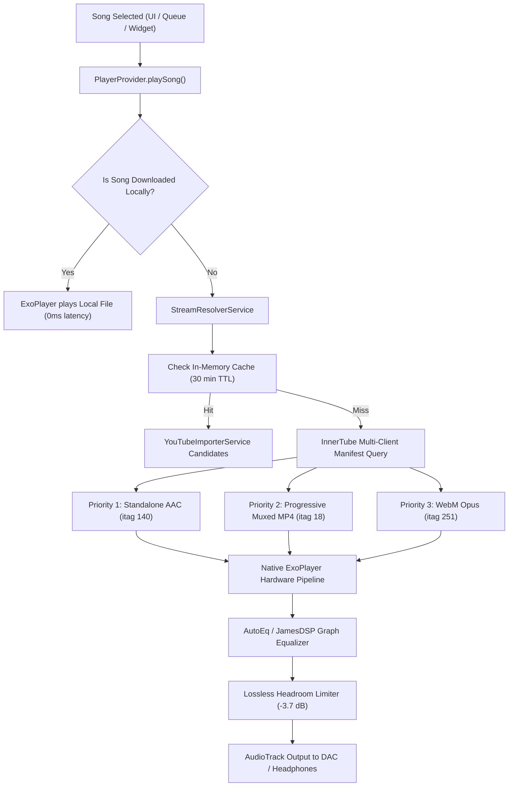

# ⚡ SINE — High-Fidelity Music Streaming (100% Free & Open Source)
<!-- TxA:29/07/2026 -->
<div align="center">

```
  ███████╗██╗███╗   ██╗███████╗
  ██╔════╝██║████╗  ██║██╔════╝
  ███████╗██║██╔██╗ ██║█████╗  
  ╚════██║██║██║╚██╗██║██╔══╝  
  ███████║██║██║ ╚████║███████╗
  ╚══════╝╚═╝╚═╝  ╚═══╝╚══════╝
```

### *Pure acoustics. Zero telemetry. No monthly subscription. 🎧✨*

[-00D2FF?style=for-the-badge&logo=android&logoColor=white)](https://github.com/taezeem14/Sine/releases/latest)
[](LICENSE)
[](https://github.com/taezeem14/Sine)
[](https://github.com/taezeem14/Sine)
[](#-open-source-credits--attribution-gpl-30)
[](#-support-the-project-upi)

<br/>

### [👉 📲 DOWNLOAD LATEST APK (v1.3.5)](https://github.com/taezeem14/Sine/releases/latest/download/Sine-v1.3.5.apk) 👈

*Tap above to download the APK, install on Android 8.0+, and enjoy studio-grade ad-free music instantly.*

<br/>

[🌐 Official Sine Website](https://taezeem14.github.io/Sine/) • [🐛 Report Bug](https://github.com/taezeem14/Sine/issues) • [💬 Request Feature](https://github.com/taezeem14/Sine/issues)

</div>

---

## 📖 Table of Contents
- [What Is Sine?](#-what-is-sine)
- [What's New in v1.3.5](#-whats-new-in-v135)
- [What's New in v1.3.4](#-whats-new-in-v134)
- [Key Features](#-key-features)
- [Architecture & Playback Pipeline](#-architecture--playback-pipeline)
- [FOSS & Privacy Guarantee](#-foss--privacy-guarantee)
- [Installation Guide](#-installation-guide)
  - [1. Direct GitHub Release APK](#1-direct-github-release-apk)
  - [2. ADB CLI Deployment](#2-adb-cli-deployment)
- [Gestures & Quick Controls](#-gestures--quick-controls)
- [Building from Source](#-building-from-source)
- [Support the Project (UPI)](#-support-the-project-upi)
- [Open Source Credits & Attribution](#-open-source-credits--attribution-gpl-30)

---

## 💅 What Is Sine?

**Sine** is an independent, high-fidelity music streaming client for Android that merges **Spotify's obsidian design language** with **NewPipe's privacy-focused YouTube extraction engine** and **studio-grade open-source DSP acoustic models** (AutoEq, JamesDSP, Equalizer APO).

Commercial streaming platforms charge \$11+/month, clutter interfaces with video podcasts, and harvest your listening habits. Sine provides:
- **Zero Subscriptions & Zero Ads**: Clean, direct audio streaming from YouTube & YouTube Music.
- **Studio Acoustics**: AutoEq acoustic targets, JamesDSP audio algorithms, and hardware parametric EQ.
- **No Logins or Accounts Required**: Zero account bans, zero tracking cookies, and zero Google/Spotify credentials.
- **Pure Local Data**: Playlists, listening history, and cached media remain 100% on your device.
- **Sub-1.2s Cold-Start Playback**: Progressive hardware decoding starting audio almost instantaneously.
- **Direct Public Storage Vault**: Music downloads save directly to `/storage/emulated/0/Sine-Music` with standard ID3 tags and HD artwork.

---

## 🌟 What's New in v1.3.5

1. **Loudness Normalization (ReplayGain / EBU R128 Leveling)**:
   - Automated target loudness balancing across tracks using Android `LoudnessEnhancer` audio effects session, preventing abrupt volume spikes when transitioning between songs.
2. **Skip Silence / Dead Air Trimming**:
   - Automated trimming of dead air and leading silence at the start of tracks for immediate, punchy transitions.
3. **1-Tap Slowed + Reverb & Nightcore Modes**:
   - Instant acoustic transformation chips in Sound Shaping:
     - 🌙 **Slowed + Reverb**: 0.85x speed with -2 semitone pitch shifting, deep spatial widening, and resonant sub-bass.
     - ⚡ **Nightcore**: 1.25x speed with +3 semitone pitch shifting, crisp vocal air EQ, and fast rhythmic punch.
4. **Dynamic Bass Exciter & 3D Spatializer Dials**:
   - Dedicated hardware sound shaping sliders: dynamic sub-bass harmonic resonance and 3D stereo widening simulation.
5. **Fluid Mesh Gradient / Dynamic Palette Glow**:
   - Ambient, breathing 3-point radial gradient glow dynamically extracted from current track artwork and rendered behind the vinyl player disc in Now Playing.
6. **Shareable Lyric Story Cards**:
   - Select 1–4 favorite lyric lines from the synchronized karaoke view, choose from 4 aesthetic glassmorphic palettes (`OLED Glass`, `Sunset Aura`, `Cyber Neon`, `Minimal Obsidian`), and render/share high-resolution PNG story cards.
7. **Minimalist Car / Driving Mode**:
   - High-contrast, distraction-free driving UI with giant 92dp touch targets, prominent track typography, and horizontal swipe gestures (swipe left/right to skip). Accessible directly from the Now Playing header.
8. **Local Device Music Scanner (Hybrid Player)**:
   - Indexes local offline audio files (`.mp3`, `.m4a`, `.flac`, `.wav`, `.aac`, `.ogg`) stored on `/storage/emulated/0/Music` and `Download`, playing device music side-by-side with online YouTube tracks.
9. **Spotify & Apple Music Playlist Importer**:
   - Paste any public Spotify or Apple Music playlist link to automatically resolve titles and artists to direct YouTube streaming audio equivalents without needing Spotify API keys.
10. **Aesthetic Playlist Covers**:
    - Choose from 6 procedurally rendered geometric gradient themes (`Neon Pulse`, `Midnight Violet`, `Cyber Amber`, `Aurora Wave`, `Hyper Pink`, `Obsidian Minimal`) or device photos for custom playlist artwork.
11. **Native Motion Gestures (Shake to Skip & Flip to Pause)**:
    - Hardware accelerometer integration: physical shake to advance track, and flip phone face down to pause (face up to resume).
12. **Android Auto Support**:
    - Declared automotive media service metadata (`automotive_app_desc.xml`) for seamless integration with Android Auto dashboard head units.
13. **Notification-Style Widget with Real Album Art**:
    - Upgraded home screen widget with asynchronous background artwork loading, rounded corners, and full Redmi Note 5 Pro MIUI whitelist compatibility.
14. **Jitter-Free 120 FPS List Scrolling**:
    - Optimized list rendering with `cacheExtent: 800`, `RepaintBoundary` isolation, and unified `BouncingScrollPhysics` across all tabs.

---

## 🌟 What's New in v1.3.4

1. **Android Media Notification-Panel Style Widget**:
   - Redesigned home screen widget styled directly after modern Android media notification shades: rounded artwork card container, prominent track title, subtitle, horizontal progress bar scrubber line, and circular accent play/pause controls.
   - Purged Android 12 (API 31) metadata attributes (`targetCellWidth`, `targetCellHeight`) that caused parser rejections in older launchers (e.g. Xiaomi Redmi Note 5 Pro MIUI 10/11/12 launcher `com.miui.home`).
   - Retained strict RemoteViews whitelist compliance (no bare `<View>` tags, no dynamic attributes).

2. **Downloaded Videos Section & External Gallery / MP4 Player Support**:
   - Added dedicated "Downloaded Videos" gallery in the Library tab alongside downloaded audio with an intuitive sub-tab switcher (`Audio` / `Videos`).
   - Registered `androidx.core.content.FileProvider` and native Android intent handler (`openVideo`) with `Intent.FLAG_GRANT_READ_URI_PERMISSION`, allowing videos to open seamlessly in your device's default Gallery, Google Photos, VLC, or MX Player.
   - Includes full video metadata (title, artist, formatted size in MB) and dismissible swipe-to-delete with undo.

3. **Playlist Reordering & Dismissible Swipe-to-Delete**:
   - Added drag-and-drop track reordering with haptic feedback to playlist detail screens and downloaded lists.
   - Added dismissible swipe-to-delete with red trash indicators and undo action SnackBars across playlists and library items.

4. **Trending Electric & Dance Section with Anti-Spam Curation**:
   - Refocused the trending category on verified electronic, dance, and chart-topping English tracks.
   - Implemented strict track validation: capped maximum duration to 8 minutes (480s) and blacklisted long mixes, compilations, "Top HITS 2026", and in-video playlists.

5. **App-Wide 120 FPS Butter Smoothness & Rebuild Elimination**:
   - Eliminated broad root `context.watch<PlayerProvider>()` across Home, Search, and Library tabs, replacing them with granular `context.select` hooks.
   - Idle tabs now experience zero rebuild overhead during background audio playback, eliminating micro-stutters and dropped frames.

---

## 🚀 Key Features

| Category | Capability | Technical Details |
| :--- | :--- | :--- |
| **Acoustics** | **Studio Open-Source Equalizer** | Calibrated AutoEq Harman targets, JamesDSP clarity models, and Equalizer APO contours with touch-draggable Bezier spline visualizer across `60 Hz`, `150 Hz`, `400 Hz`, `1 kHz`, `2.4 kHz`, `15 kHz`. |
| **Acoustics** | **Lossless Pitch & Speed Guard** | Dynamic -3.7 dB pre-amp limiter absorbing Sonic SOLA constructive interference spikes, preventing clipping and keeping hardware DSP effects permanently anchored. |
| **Discovery** | **Curated Genre Deep Explorer** | High-precision genre browsing powered by iTunes Search API with instant 'Play All', 'Shuffle', and direct YouTube stream resolution. |
| **Theming** | **Dynamic Accent Themes & Color Studio** | 8 vibrant presets (Electric Blue, Emerald Green, Sunset Orange, Crimson Red, Electric Yellow, Neon Purple, Monochromatic, Custom) with real-time app repaint and custom RGB slider/hex color studio in Settings. |
| **Widgets** | **Instant-Hydration Home Screen Widget** | 4x2 responsive Android widget with immediate state restoration upon placement and direct in-process audio transport controls (Play/Pause, Next, Previous). |
| **Acoustics** | **Native ExoPlayer DSP Engine** | Multi-candidate stream cascade prioritizing Progressive Muxed MP4 (itag 18) for instant hardware decoding, with standalone AAC (128 kbps) and WebM Opus (160 kbps) fallbacks. |
| **Playback** | **Smart Sleep Timer** | Drift-compensated countdown timer resilient to Android Doze mode, with "End of Track" sleep support. |
| **Playback** | **Gapless Crossfade** | Configurable audio crossfade for smooth, continuous transitions between tracks. |
| **Lyrics** | **Synchronized Karaoke Lyrics** | Auto-scrolling LRC lyrics from LRCLIB with millisecond tap-to-seek and tempo-modified guard. |
| **Offline** | **Public Storage Vault** | Direct track downloads to `/storage/emulated/0/Sine-Music` with embedded ID3 metadata and artwork. |
| **Sharing** | **Sine QR Code** | 100% offline, on-device QR generator & scanner for sharing tracks and playlists without internet. |
| **Security** | **App Lock** | Local 4-digit PIN authentication securing your library and downloads. |
| **Discovery** | **Audile Music Detection** | Live microphone acoustic recognition radar with real-time waveform visualization, AudD/Shazam multi-provider matching, and instant 1-tap playback & library save. |

---

## 📐 Architecture & Playback Pipeline

Sine utilizes a robust multi-tier fallback architecture ensuring uninterrupted streaming even when YouTube applies throttling or signature cipher updates:



---

## 🛡️ FOSS & Privacy Guarantee

- **Zero Telemetry**: No Google Analytics, Firebase Analytics, Crashlytics, or tracking SDKs compiled into the binary.
- **Zero Logins Required**: No Google accounts, OAuth tokens, or credential harvesting.
- **Complete Local Independence**: Offline database stored in on-device SQLite (`sqflite`), completely accessible to the user.
- **GNU GPL-3.0**: 100% Free and Open-Source Software forever.

---

## 📲 Installation Guide

### 1. Direct GitHub Release APK
1. Download the latest release: [**Sine-v1.3.1.apk**](https://github.com/taezeem14/Sine/releases/latest/download/Sine-v1.3.1.apk).
2. Open the `.apk` on your Android device (Android 8.0+ Oreo or newer).
3. If prompted, allow "Install from Unknown Sources" in Android Settings.
4. Launch Sine and start streaming immediately!

### 2. ADB CLI Deployment
If your phone is connected via USB debugging:
```bash
adb install -r Sine-v1.3.1.apk
```

---

## 🎮 Gestures & Quick Controls

| Gesture / Action | Location | Outcome |
| :--- | :--- | :--- |
| **Swipe Down Mini Player** | Bottom of Screen | Dismisses active track |
| **Swipe Right on Track** | Any Song Tile | Adds track to the top of the Up Next Queue |
| **Tap Lyrics Line** | Synchronized Lyrics View | Seeks playback directly to that lyric timecode |
| **Long Press Track** | Any Playlist / Search List | Opens Track Options (Add to playlist, download, share) |
| **Draggable EQ Node** | Graph Equalizer Screen | Adjusts gain on any of the 6 calibrated audio bands |
| **Double-Tap EQ Node** | Graph Equalizer Screen | Resets that individual band to `0.0 dB Unity` |

---

## 🧑‍💻 Building from Source

### Prerequisites
- [Flutter SDK](https://flutter.dev) (v3.24.0 or higher, stable channel)
- [Android SDK](https://developer.android.com/studio) (API 34+ / Platform-tools installed)
- [Java Development Kit (JDK)](https://adoptium.net) (Version 17)

### Build Commands:
```bash
# 1. Clone the repository
git clone https://github.com/taezeem14/Sine.git
cd Sine

# 2. Fetch dependencies
flutter pub get

# 3. Verify static analysis
flutter analyze lib test

# 4. Run automated test suite
flutter test test/v131_eq_and_genre_test.dart

# 5. Build signed production APK
flutter build apk --release --no-tree-shake-icons
```

The compiled release APK will be located at:
```text
build/app/outputs/flutter-apk/app-release.apk
```

---

## 💖 Support the Project (UPI)

Sine is free, ad-free, and independently crafted with immense care. If Sine saves you from monthly subscription costs, consider tipping the creator:

<div align="center">

**UPI ID**: `7006616470@fam`  
**Beneficiary**: *Muhammad Taezeem Tariq*  
*Supported across Google Pay, PhonePe, Paytm, BHIM, and FamPay.*

</div>

---

## 👑 Credits & License

- **Created & Maintained by**: **Muhammad Taezeem Tariq** ([@taezeem14](https://github.com/taezeem14))

---

## 📜 Open Source Credits & Attribution (GPL-3.0)

Sine is proud to be built upon and inspired by the global Free and Open Source Software (FOSS) ecosystem. In strict adherence to the **GNU General Public License v3.0 (GPL-3.0)** and respective permissive licenses, we gratefully acknowledge and attribute the following outstanding open-source projects:

| Project | Authors / Organization | License | Repository | Role & Architectural Contribution |
| :--- | :--- | :--- | :--- | :--- |
| **AutoEq** | [Jaakko Pasanen](https://github.com/jaakkopasanen) | **MIT** | [jaakkopasanen/AutoEq](https://github.com/jaakkopasanen/AutoEq) | Acoustic equalization target curves (Harman In-Ear, Audiophile Neutral reference, Harman Bass Boost, Vocal Forward) providing calibrated studio baseline presets. |
| **JamesDSP** | [James34602](https://github.com/james34602) | **GPL-3.0** | [james34602/JamesDSPAudioManager](https://github.com/james34602/JamesDSPAudioManager) | Advanced audio processing algorithms, pure clarity spatial enhancement, resonant bass curves, and tube amplifier warmth simulation. |
| **Equalizer APO** | [jthedering](https://sourceforge.net/projects/equalizerapo/) | **GPL** | [Equalizer APO](https://sourceforge.net/projects/equalizerapo/) | Parametric filtering architectures and ISO 226 equal-loudness contour curves for natural human auditory compensation. |
| **Audile** | [AudileTeam](https://github.com/AudileTeam) | **GPL-3.0** | [AudileTeam/Audile](https://github.com/AudileTeam/Audile) | Open-source Android music player and recognition client. Inspires Sine's persistent foreground audio playback service and media notification lifecycle. |
| **zemer-cipher** | [ZemerTeam](https://github.com/ZemerTeam) | **GPL-3.0** | [ZemerTeam/zemer-cipher](https://github.com/ZemerTeam/zemer-cipher) | Specialized YouTube signature cipher solver and stream signature de-obfuscation algorithms, providing resilient stream extraction fallback. |
| **BetterLyrics** | [boidushya](https://github.com/boidushya) / [better-lyrics](https://github.com/better-lyrics) | **GPL-3.0** | [boidushya/better-lyrics](https://github.com/boidushya/better-lyrics) | High-fidelity synchronized lyrics engine. Inspires Sine's real-time karaoke LRC lyrics renderer, metadata normalization, and millisecond offset calibration. |
| **Metrolist** | [MetrolistGroup](https://github.com/MetrolistGroup) | **GPL-3.0** | [MetrolistGroup/Metrolist](https://github.com/MetrolistGroup/Metrolist) | Modern Material YouTube Music client for Android. Inspires Sine's queue management, offline track caching pipelines, and playlist storage architecture. |

### Additional Upstream FOSS Acknowledgments
- **[Team NewPipe](https://github.com/TeamNewPipe/NewPipe)** (GPL-3.0) — The gold standard for tracker-free, privacy-first YouTube extraction.
- **[YoutubeExplode](https://github.com/Hexer10/YoutubeExplode)** (LGPL-3.0) — High-performance Dart YouTube metadata parser and stream extraction engine.
- **[just_audio](https://github.com/ryanheise/just_audio) & [audio_service](https://github.com/ryanheise/audio_service)** by Ryan Heise — Professional background audio playback engine for Flutter.
- **[LRCLIB](https://lrclib.net/)** — Open crowd-sourced synchronized lyrics database.
- **[SponsorBlock](https://sponsor.ajay.app/)** — Open-source crowd-sourced database for skipping promotional segments.

### ⚖️ License
Sine is free software released under the **GNU General Public License v3.0 (GPL-3.0)**. You can redistribute it and/or modify it under the terms of the GNU General Public License as published by the Free Software Foundation. See [LICENSE](LICENSE) for details.
